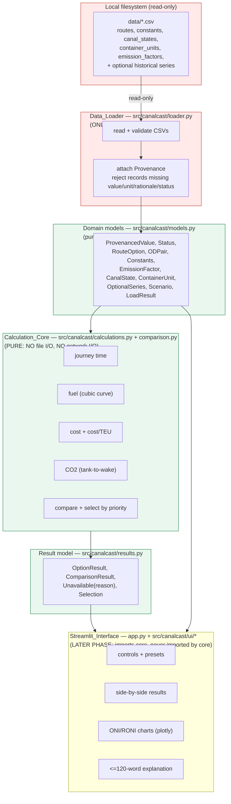

# Design Document

## Overview

CanalCast is a scenario simulator that compares a Panama Canal route option against a Suez Canal route option for one origin-destination pair, under Panama Canal operating conditions the user selects. It is explicitly **not a forecast**: every displayed number is the deterministic consequence of user-chosen scenario inputs computed by typed Python functions, and every explanation describes only the current calculated result.

This design realizes three non-negotiable principles from the product definition and the approved requirements:

1. **Python computes every displayed number.** All journey time, fuel, cost, carbon dioxide, and selection outcomes come from pure functions in the Calculation_Core. The Streamlit_Interface renders results; it never performs arithmetic that produces a displayed metric.
2. **Provenance travels with every value.** Each Model_Input carries a value, unit, source-or-assumption rationale, and a status drawn from the fixed vocabulary {`sourced`, `approximate`, `assumption`, `derived`}. Missing required values stay missing — never replaced by zero or an invented number — and the dependent calculation is disabled with a named explanation.
3. **Core before interface.** The Calculation_Core is fully specified, implemented, and passing automated tests before any Streamlit_Interface code is written (Requirement 19.1, 19.2). The module boundaries below make this ordering enforceable: the UI layer imports the core, never the reverse.

The design draws the I/O boundary sharply. The **Data_Loader** performs all file input and output (read-only) against the local `data/` folder (Requirement 1.2, 1.4). The **Calculation_Core** performs no file I/O and no network I/O (Requirement 1.3, 1.7). No module makes a network call at runtime. Optional historical series (canal events, transits, ONI, RONI, ENSO context, surcharges) never block the core comparison (Requirement 4).

This version 1 deliberately excludes tolls, insurance, carrier surcharges, lifecycle emissions, and any draft-related cargo-loss modeling, and discloses those exclusions in the result. There is no severity curve and no cargo-loss output anywhere in this design.

## Architecture

### Component and boundary diagram



**Boundary rules enforced by this layout:**

- `loader.py` is the only module that imports `pandas` for file reading or touches the filesystem. It opens files read-only and never writes to the source CSVs (Requirement 1.2, 1.4).
- `calculations.py`, `comparison.py`, `results.py`, and `models.py` import no I/O libraries (no `open`, no `requests`, no `urllib`, no network client). This is verifiable by a test that scans these modules for forbidden imports (supports Requirement 1.3, 1.7, 19.4).
- The interface layer depends on the core and models. Nothing in the core imports Streamlit. This makes "core before UI" a structural fact, not a convention (Requirement 19.1, 19.2).

### Data flow

1. **Load.** `loader.load_all(data_dir)` reads the required CSVs, validates provenance on every Model_Input, and returns a `LoadResult` holding typed records plus an availability record for each optional series. A missing or unreadable **required** file aborts loading with an error naming the file; no partial Model_Input data is produced (Requirement 1.8). A missing or unreadable **optional** series is recorded as unavailable with a reason, and loading continues (Requirement 4.2, 4.3).
2. **Build scenario.** The caller assembles a `Scenario` from user selections (or a preset) plus loaded constants. Required inputs that are absent are represented as `None`.
3. **Compute.** `comparison.compare_od_pair(od_pair, scenario, constants, emission_factor, canal_state)` computes each per-option result and the selection outcome. Each sub-calculation is independent: one disabled calculation never suppresses another whose inputs are all present (Requirement 3.4).
4. **Render.** The Streamlit layer reads the `ComparisonResult` and displays metrics, provenance, exclusions, disclosures, charts, and the deterministic explanation.

## Components and Interfaces

### Module layout under `src/`

```
src/canalcast/
    __init__.py
    models.py          # typed domain records + Status enum + ProvenancedValue + Unavailable
    loader.py          # Data_Loader: ALL file I/O; CSV read + validation + provenance
    calculations.py    # pure per-option math: time, fuel, cost, CO2
    comparison.py      # pure OD-pair comparison + priority selection + tie handling
    results.py         # OptionResult / ComparisonResult / Selection result structures
    explain.py         # deterministic <=120-word explanation from a ComparisonResult (pure)
    ui/                # Streamlit_Interface (LATER PHASE)
        __init__.py
        controls.py    # presets + scenario input controls
        views.py       # side-by-side results, disclosure panel
        charts.py      # ONI/RONI plotly charts with missing-series notes
app.py                 # Streamlit entry point: wires loader -> core -> ui
tests/
    test_calculations.py   # pytest + hypothesis property tests + worked examples
    test_comparison.py
    test_loader.py
    test_no_io_boundary.py # asserts core modules import no I/O/network libs
requirements.txt           # pinned, exact versions
```

`explain.py` lives in the core (pure) because Requirement 17 requires the explanation be derived solely from the current result with no network call; keeping it pure makes that guarantee testable.

### Key interfaces (signatures are illustrative; types defined in Data Models)

```python
# loader.py  (the only module performing I/O)
def load_all(data_dir: Path) -> LoadResult: ...
def load_required(data_dir: Path) -> RequiredData: ...        # routes, constants, canal_states, container_units, emission_factors
def load_optional(data_dir: Path) -> dict[str, OptionalSeries]: ...

# calculations.py  (pure)
def sailing_time_hours(distance_nm: float, speed_kn: float) -> ResultOrUnavailable[float]: ...
def journey_time_hours(sailing_h, canal_duration_h, waiting_duration_h) -> ResultOrUnavailable[float]: ...
def fuel_rate_t_per_day(speed_kn, base_fuel_t_per_day, base_speed_kn, speed_exponent) -> ResultOrUnavailable[float]: ...
def sailing_fuel_t(fuel_rate_t_per_day: float, sailing_time_hours: float) -> ResultOrUnavailable[float]: ...
def voyage_fuel_cost_usd(total_fuel_t: float, bunker_price_usd_per_t: float) -> ResultOrUnavailable[float]: ...
def loaded_teu(capacity_teu: float, load_factor: float) -> ResultOrUnavailable[float]: ...
def fuel_cost_per_teu_usd(voyage_fuel_cost_usd: float, loaded_teu: float) -> ResultOrUnavailable[float]: ...
def co2_tank_to_wake_t(total_fuel_t: float, factor: EmissionFactor, selected_fuel_type: str) -> ResultOrUnavailable[float]: ...

# comparison.py  (pure)
def compute_option(route_opt: RouteOption, scenario: Scenario, constants: Constants,
                   emission_factor: EmissionFactor | None) -> OptionResult: ...
def compare_od_pair(od_pair: ODPair, scenario: Scenario, constants: Constants,
                    emission_factor: EmissionFactor | None, canal_state: CanalState) -> ComparisonResult: ...

# explain.py  (pure)
def explain(result: ComparisonResult, max_words: int = 120) -> str: ...
```

## Data Models

All domain records are immutable (`@dataclass(frozen=True)`), fully type-hinted, and contain no methods that perform I/O. Missing **required** values are modeled with `Optional[...] = None`; they are never defaulted to zero (Requirement 3.3).

### Status and provenance

```python
class Status(str, Enum):
    SOURCED = "sourced"
    APPROXIMATE = "approximate"
    ASSUMPTION = "assumption"
    DERIVED = "derived"

@dataclass(frozen=True)
class ProvenancedValue:
    value: float | str                 # str allowed for non-numeric/range context values
    unit: str
    rationale: str                     # source URL or assumption rationale (Requirement 2.1)
    status: Status
    retrieved_on: date | None = None   # retained when present (Requirement 1.6)
    method: str | None = None          # retained when present (Requirement 1.6)
    derived_from: tuple[str, ...] = () # non-empty required WHEN status == DERIVED (Requirement 2.4)
    derivation: str | None = None      # non-empty required WHEN status == DERIVED (Requirement 2.4)
```

The loader rejects any Model_Input record missing value, unit, rationale, or status, preserves the original record unchanged, and reports the record identifier and which field is absent (Requirement 1.9, 2.3, 2.5, 2.6). A status value outside the four allowed strings is rejected with the record id and the unrecognized value (Requirement 2.3).

**Non-numeric / range constants.** Some `constants.csv` values are ranges (e.g. `panamax_locks_capacity_per_day = "34-36"`, `neopanamax_locks_capacity_per_day = "9-11"`). The loader keeps these as `str` context values inside `ProvenancedValue.value` and never coerces them to float. Only the specific keys the Calculation_Core consumes (listed under Constants below) are parsed as floats; a parse failure on a computational key is surfaced as an error for that key, not a crash.

### Required domain records

```python
@dataclass(frozen=True)
class RouteOption:
    route_id: str
    origin: str
    destination: str
    option: Literal["panama", "suez"]
    distance_nm: ProvenancedValue | None     # None if absent -> journey time disabled (Req 6.6)
    origin_lon: float; origin_lat: float
    destination_lon: float; destination_lat: float
    passages: str                              # context label, e.g. "babalmandab;gibraltar;malacca;suez"
    provenance: ProvenancedValue               # status "approximate" for v1 route distances

@dataclass(frozen=True)
class ODPair:
    route_id: str
    origin: str
    destination: str
    panama: RouteOption | None
    suez: RouteOption | None

@dataclass(frozen=True)
class EmissionFactor:
    fuel_type: str                             # "HFO" | "LFO" | "MDO"
    co2_t_per_fuel_t: ProvenancedValue         # status sourced
    scope: str                                 # "tank_to_wake_CO2_only"
    unit: str                                  # "t_CO2/t_fuel"

@dataclass(frozen=True)
class CanalState:
    state: str                                 # normal_reference, current_oct2026, ...
    max_draft_ft: ProvenancedValue             # CONTEXT only in v1 (Req 10)
    daily_slots: ProvenancedValue              # booking-slot limit, NOT an actual transit (Req 5.1)
    period: str
    provenance: ProvenancedValue

@dataclass(frozen=True)
class ContainerUnit:
    container_type: Literal["20ft", "40ft"]
    teu_per_container: int                      # 1 for 20ft, 2 for 40ft (Req 5.3)
    provenance: ProvenancedValue

@dataclass(frozen=True)
class Constants:
    # Only the keys the core consumes, parsed to float with provenance:
    ship_capacity_teu: ProvenancedValue         # 10000, assumption
    load_factor: ProvenancedValue               # 0.85, assumption
    default_speed_kn: ProvenancedValue           # 18, approximate
    base_speed_kn: ProvenancedValue              # 22, secondary_source
    base_fuel_t_per_day: ProvenancedValue        # 175, approximate
    speed_exponent: ProvenancedValue             # 3, derived
    bunker_price_usd_per_t: ProvenancedValue     # 876.5, sourced
    reference_draft_ft: ProvenancedValue         # 50.0, sourced (context)
    canal_wait_days_default: ProvenancedValue    # 0, assumption (default waiting TIME)
    # Fuel RATES for waiting/canal operation are NOT present in constants.csv.
    waiting_fuel_t_per_day: ProvenancedValue | None = None   # unresolved input (Req 7.5)
    canal_fuel_t_per_day: ProvenancedValue | None = None     # unresolved input (Req 7.5)
    # Raw context values (ranges, gatun levels, lost-containers estimate) kept but NOT used in v1:
    context: dict[str, ProvenancedValue] = field(default_factory=dict)
```

`containers_lost_per_10cm_draft_cut` is loaded only into `context` and is **never** read by the Calculation_Core in v1 (Requirement 10.2, 10.3, 19.4).

### Optional series availability

```python
@dataclass(frozen=True)
class OptionalSeries:
    name: str                                   # "oni", "roni", "canal_events", ...
    available: bool
    reason: str | None                          # e.g. "not found", "could not be read" (Req 4.2, 4.3)
    rows: tuple[Mapping[str, object], ...] = () # populated only when available
    provenance: ProvenancedValue | None = None

@dataclass(frozen=True)
class LoadResult:
    required: RequiredData                       # routes/od_pairs, constants, canal_states, container_units, emission_factors
    optional: Mapping[str, OptionalSeries]       # one entry per optional series, available or not
```

### Scenario

```python
@dataclass(frozen=True)
class Scenario:
    od_pair_id: str
    speed_kn: float | None
    load_factor: float | None
    bunker_price_usd_per_t: float | None
    canal_duration_h: float | None
    waiting_duration_h: float | None             # from explicit input; default 0 by assumption (Req 6.2, 6.3)
    deadline_h: float | None
    suez_available: bool                          # explicit scenario assumption (Req 11.2)
    selection_priority: Literal["fastest", "lowest_cost_per_teu", "lowest_co2"]
    fuel_type: str                                # selects the matching EmissionFactor
    canal_state: CanalState                        # draft shown as CONTEXT (Req 10)
```

### The missing/unavailable pattern

A single pattern is used consistently across the core: **Optional-with-reason**. Any computed value that cannot be produced is represented by an `Unavailable` object carrying a human-readable reason and the names of the missing or invalid inputs — never by `0`, `None` alone, `NaN`, or `inf`.

```python
@dataclass(frozen=True)
class Unavailable:
    reason: str
    missing_inputs: tuple[str, ...] = ()
    invalid_inputs: tuple[str, ...] = ()

# Alias used across calculation signatures:
ResultOrUnavailable = Union[T, Unavailable]      # where T is the computed numeric value
```

## The Result Structure

This is the contract agreed in design before implementation. Every numeric field carries its unit in the field name or an attached unit string, and every field that may be absent is an `Unavailable` rather than a substituted value.

```python
@dataclass(frozen=True)
class JourneyTimeBreakdown:
    sailing_time_h: ResultOrUnavailable[float]
    canal_duration_h: ResultOrUnavailable[float]
    waiting_duration_h: ResultOrUnavailable[float]
    journey_time_h: ResultOrUnavailable[float]      # sum when all parts present (Req 6.5)

@dataclass(frozen=True)
class FuelBreakdown:
    fuel_rate_t_per_day: ResultOrUnavailable[float]
    sailing_fuel_t: ResultOrUnavailable[float]
    waiting_fuel_t: ResultOrUnavailable[float]      # distinct line item; Unavailable if rate missing (Req 7.4, 7.5)
    canal_fuel_t: ResultOrUnavailable[float]        # distinct line item; Unavailable if rate missing (Req 7.4, 7.5)
    total_voyage_fuel_t: ResultOrUnavailable[float] # sum of resolved fuel line items

@dataclass(frozen=True)
class OptionResult:
    option: Literal["panama", "suez"]
    route_id: str
    units: Mapping[str, str]                        # explicit unit per metric (Req 11.10)

    journey: JourneyTimeBreakdown
    fuel: FuelBreakdown
    loaded_teu: ResultOrUnavailable[float]
    voyage_fuel_cost_usd: ResultOrUnavailable[float]
    fuel_cost_per_teu_usd: ResultOrUnavailable[float]   # Unavailable(reason="loaded TEU is zero") when payload 0 (Req 8.4)
    co2_tank_to_wake_t: ResultOrUnavailable[float]      # labeled tank-to-wake, NOT lifecycle (Req 9.5)

    feasible: bool | None                           # journey_time_h <= deadline_h; None if time unavailable
    deadline_status: str                            # "meets deadline" | "misses deadline" | "undetermined"
    infeasible: bool                                # True when loaded_teu == 0 (Infeasible_Result, Req 11.9)
    infeasible_reason: str | None

    draft_context_ft: ProvenancedValue              # canal-state max draft as CONTEXT label (Req 10.1)
    draft_not_modeled_disclosure: str               # fixed text: draft cargo-capacity effects not modeled in v1 (Req 10.4)
    exclusions: tuple[str, ...]                     # tolls, insurance, carrier surcharges, lifecycle emissions, draft cargo-loss (Req 8.6)
    cost_label: str = "fuel cost"                   # never "total shipping cost" (Req 8.8)
    input_provenance: Mapping[str, ProvenancedValue]  # provenance for each input behind this option (Req 11.10)

@dataclass(frozen=True)
class Selection:
    selected_option: Literal["panama", "suez"] | None   # None when no feasible option (Req 11.5)
    priority: str                                        # the Selection_Priority used
    no_feasible_option: bool
    closest_option: Literal["panama", "suez"] | None     # min journey time when none feasible (Req 11.5)
    tie_resolution: str | None                           # which tie step resolved it (Req 11.8)
    message: str                                         # plain-language outcome

@dataclass(frozen=True)
class ComparisonResult:
    od_pair_id: str
    panama: OptionResult | None
    suez: OptionResult | None
    excluded_options: tuple[str, ...]                    # e.g. ("suez",) when marked unavailable (Req 11.3)
    exclusion_reasons: Mapping[str, str]
    selection: Selection
    comparison_error: Unavailable | None                 # set when an OD_Pair lacks a valid pair of distances (Req 11.1)
    disclaimer: str = "Scenario tool — not a forecast."
```

Notes that pin down the contract:

- **Undefined per-TEU cost** is `Unavailable(reason="loaded TEU is zero")`, explicitly not `0` and not `inf` (Requirement 8.4).
- **Infeasible option** (zero loaded TEU) sets `infeasible=True`, keeps `fuel_cost_per_teu_usd` as `Unavailable`, and the comparison excludes it from selection when the active priority is `lowest_cost_per_teu` (Requirement 11.9).
- **Draft** appears only as `draft_context_ft` plus the `draft_not_modeled_disclosure`; it never reduces TEU, cost, fuel, or CO2 (Requirement 10). There are no severity-curve or cargo-loss fields.
- **Booking-slot limit vs actual transit**: `CanalState.daily_slots` is labeled a booking-slot limit; actual transits (from the optional `transits.csv`) are a separate labeled quantity and are never presented as interchangeable (Requirement 5.1).

## Correctness Properties

*A property is a characteristic or behavior that should hold true across all valid executions of a system — essentially, a formal statement about what the system should do. Properties serve as the bridge between human-readable specifications and machine-verifiable correctness guarantees.*

The Calculation_Core is a set of pure functions over numeric inputs with clear input/output behavior (sailing time, a cubic fuel curve, cost, CO2, and a deterministic selection rule). This is exactly the class of code where property-based testing adds value, so correctness properties are specified below and map to Requirement 18. UI rendering, preset population, and chart layout are covered by example and snapshot tests instead (noted in Testing Strategy), not by properties.

### Property 1: Worked examples match within tolerance

*For any* worked example in the fixed example set (sailing time, cubic fuel rate, voyage fuel cost, cost per TEU, CO2), the Calculation_Core result equals the expected value within a relative tolerance of 1e-9.

**Validates: Requirements 18.1**

### Property 2: Fuel and CO2 are non-negative for valid inputs

*For any* set of Required_Inputs that are all present, finite, and within their documented valid ranges, the computed total voyage fuel in tonnes and the computed tank-to-wake carbon dioxide in tonnes are each greater than or equal to zero.

**Validates: Requirements 18.2**

### Property 3: Sailing fuel is monotonic in distance

*For any* fixed valid speed and ship configuration, and any two distances with the first less than or equal to the second, the sailing fuel for the smaller distance is less than or equal to the sailing fuel for the larger distance.

**Validates: Requirements 18.3**

### Property 4: Higher speed strictly shortens sailing time

*For any* fixed positive distance and any two valid speeds with the first strictly less than the second, the sailing time at the higher speed is strictly less than the sailing time at the lower speed.

**Validates: Requirements 18.4**

### Property 5: Higher speed strictly increases sailing fuel under the cubic curve

*For any* fixed positive distance and ship configuration, and any two valid speeds with the first strictly less than the second, the sailing fuel at the higher speed is strictly greater than the sailing fuel at the lower speed.

**Validates: Requirements 18.5**

### Property 6: A feasible option is never passed over for an infeasible one

*For any* comparison in which at least one non-excluded option is a Feasible_Option, the selected option is a Feasible_Option, and no option that misses the deadline is selected over a Feasible_Option.

**Validates: Requirements 11.4, 18.6**

### Property 7: Selection minimizes the chosen priority metric

*For any* comparison with at least one Feasible_Option and a chosen Selection_Priority, the selected option's priority metric is less than or equal to every other non-excluded Feasible_Option's priority metric (ties resolved by the tie rule).

**Validates: Requirements 11.4, 11.6**

### Property 8: Tie handling is deterministic

*For any* two Feasible_Options whose priority metric values are equal within 0.001 of the metric unit, the option with the lower Journey_Time is selected; *for any* such pair whose Journey_Time values are also equal within 0.001 hours, the Panama option is selected, and the resolving tie step is recorded.

**Validates: Requirements 11.7, 11.8**

### Property 9: Invalid speed yields an explicit Unavailable, not a number

*For any* speed less than or equal to zero knots, the sailing-time calculation returns an `Unavailable` that names the invalid speed, and no sailing time or sailing fuel value is produced.

**Validates: Requirements 6.7, 18.7**

### Property 10: Missing distance disables journey time without substitution

*For any* Route_Option whose distance is missing, the journey-time calculation for that option returns an `Unavailable` naming the missing distance, and no distance value is substituted.

**Validates: Requirements 6.6, 18.8**

### Property 11: Zero loaded TEU yields undefined per-TEU cost, not zero

*For any* option whose loaded TEU is zero, the fuel cost per loaded TEU is `Unavailable` with a recorded reason, never a zero or invented value, and the option is excluded from selection when the active priority is lowest fuel cost per TEU.

**Validates: Requirements 8.4, 11.9, 18.9**

### Property 12: Container-to-TEU conversion is exact and type-guarded

*For any* container record whose type is `20ft` or `40ft`, the conversion yields exactly 1 or 2 TEU per container respectively; *for any* unsupported container type, the TEU value is left missing, only that conversion is disabled, and every other labeled quantity is still produced.

**Validates: Requirements 5.3, 5.4**

### Property 13: Independent evaluation of calculations

*For any* scenario in which one calculation is disabled by a missing Required_Input, every other calculation whose Required_Inputs are all present is still computed to a numeric value.

**Validates: Requirements 3.4**

### Property 14: Optional-series absence does not block the comparison

*For any* OD_Pair whose Required_Inputs are present, the comparison produces a complete per-option result and a selection outcome even when every Optional_Historical_Series is recorded as unavailable.

**Validates: Requirements 4.4, 4.5**

### Property 15: CO2 requires an exactly matching fuel type

*For any* selected fuel type, the carbon dioxide calculation uses an Emission_Factor whose fuel type is an exact match; if the selected fuel type has no matching factor, the carbon dioxide result is `Unavailable` with a mismatch or missing-factor reason, and no CO2 number is produced.

**Validates: Requirements 9.2, 9.3, 9.4**

## Error Handling

The system uses one consistent error-handling pattern, the **Optional-with-reason** `Unavailable` object, for every situation where a value cannot be produced. The core never raises on bad-but-expected inputs; it returns `Unavailable`. The loader raises/returns structured load errors only for file-level and provenance-validation failures.

| Condition | Handling | Requirement |
|---|---|---|
| Required CSV missing/unreadable | Abort load; error names the file; no partial Model_Input data | 1.8 |
| Model_Input missing value/unit/rationale/status | Reject record, preserve original unchanged, report record id + missing field | 1.9, 2.3, 2.5, 2.6 |
| Status not in {sourced, approximate, assumption, derived} | Reject record, report id + unrecognized value | 2.3 |
| `derived` without derived_from/method | Reject record, report id | 2.4 |
| Optional series absent | Record unavailable with reason "not found"; continue loading others | 4.2 |
| Optional series present but unreadable | Record unavailable with reason "could not be read"; continue | 4.3 |
| Speed ≤ 0 knots | `Unavailable` naming invalid speed; sailing time/fuel not produced | 6.7 |
| Distance missing | `Unavailable` naming missing distance; journey time disabled | 6.6 |
| Canal or waiting duration missing/negative | `Unavailable` naming which duration; journey time disabled | 6.8 |
| Waiting/canal **fuel rate** missing from constants | That line item is `Unavailable` (unresolved input); other fuel figures still reported | 7.5 |
| Loaded TEU zero | `fuel_cost_per_teu_usd` = `Unavailable(reason)`; Infeasible_Result; excluded from cost-per-TEU selection | 8.4, 11.9 |
| Load factor outside [0,1] | Affected outputs `Unavailable`, naming the invalid input | 8.5 |
| Fuel-type / emission-factor mismatch or no factor | CO2 `Unavailable` with reason; CO2 not produced | 9.3, 9.4 |
| Unsupported container type | Disable only that conversion; keep all other labeled quantities | 5.4 |
| OD_Pair lacks both positive panama & suez distances | `comparison_error` = `Unavailable` naming the missing/invalid distance; comparison rejected | 11.1 |
| Suez marked unavailable | Exclude Suez from selection; record the exclusion | 11.3 |
| No feasible option | Selection has `no_feasible_option=True`, reports closest option by min journey time, makes no selection | 11.5 |
| UI numeric input out of range | Reject value, retain last valid Scenario, show which input is out of range | 13.7 |

**No substitution rule.** In every "missing/invalid" row above, the core leaves the value missing and never substitutes a default, zero, or invented number (Requirement 3.3). This is asserted by Properties 9–11 and 13.

## Testing Strategy

The Calculation_Core is implemented and fully tested **before** any Streamlit_Interface code is written (Requirement 19.1, 19.2). A boundary test (`test_no_io_boundary.py`) parses the core modules and asserts they import no file-I/O or network libraries, backing Requirements 1.3, 1.7, and 19.4.

### Dual approach

- **Property-based tests** (pytest + Hypothesis) verify the universal properties above across generated inputs. Each property test runs a **minimum of 100 iterations** and is tagged with a comment in the form `# Feature: canalcast, Property N: <property text>`. Each correctness property is implemented by a single property-based test.
- **Example-based unit tests** verify the fixed worked numbers, edge cases, and error branches (Property 1 / Requirement 18.1), including the documented `check_fuel` discrepancy below.

### Hypothesis strategies

- `valid_speed`: floats in a realistic sailing band (e.g. 1.0–30.0 kn), strictly positive; a separate `invalid_speed` strategy draws values ≤ 0 for Property 9.
- `distance_nm`: floats across the observed route range and beyond (e.g. 1.0–30000.0 nm) for monotonicity (Properties 3–5).
- `load_factor`: floats in [0.0, 1.0] for valid cases; an out-of-range strategy for error branches; a zero-payload case (capacity × 0 or capacity 0) for Property 11.
- `fuel_type`: sampled from {HFO, LFO, MDO} for matching cases and from unmatched strings for Property 15.
- `priority` and two generated `OptionResult`s with controlled metrics for selection and tie properties (Properties 6–8), including pairs engineered to sit within 0.001 of each other.
- `container_type`: {20ft, 40ft} plus unsupported types for Property 12.

### Worked examples (example-based)

At 18 kn with base 175 t/day at 22 kn and exponent 3: `175 * (18/22)^3 ≈ 95.9 t/day`. This is near the `check_fuel_t_per_day_at_18kn = 109` sanity target from `constants.csv`. The ~96 vs 109 t/day gap is a **documented discrepancy**, not a test failure — the model is driven by the cubic curve constants, and the check value is a secondary-source sanity target only. The example test asserts ~96 from the curve and records the 109 target as context.

Additional example tests cover: sailing time `distance/speed`, voyage fuel cost `total_fuel * bunker_price`, loaded TEU `10000 * 0.85 = 8500`, cost per TEU, and CO2 `total_fuel * 3.114` for HFO.

### UI-phase tests (later)

Preset population, control ranges, side-by-side layout, disclosure text, chart missing-series notes, and the ≤120-word explanation are covered by example and snapshot tests, not property tests, consistent with the PBT-applicability guidance (UI rendering is not a pure-function property domain).

## Streamlit Interface Design (Later Phase)

The interface imports the Calculation_Core and renders its `ComparisonResult`. It is built only after the core passes its tests (Requirement 19.2).

### Presets and custom scenario (Requirement 12)

- **Normal reference** preset → populates draft 50.0 ft and 36 slots/day from the `normal_reference` canal state.
- **October 2026 snapshot** preset → populates draft 49.0 ft and 33 slots/day from `current_oct2026`.
- **Custom** → user sets draft (ft) and booking-slot count (whole slots/day) directly, alongside the other scenario inputs. A missing required custom input disables the dependent calculation and states in plain language what value is needed (Requirement 12.6).

### Controls (Requirement 13)

Route selection (restricted to OD_Pairs having both a Panama and a Suez distance — all three present pairs qualify), speed (kn, > 0), load factor ([0,1]), bunker price (USD/t, > 0), waiting duration (days, ≥ 0), deadline (days, > 0), Selection_Priority (exactly: fastest journey time, lowest fuel cost per TEU, lowest CO2), and Suez availability (available | unavailable). Changing any in-range control recomputes from the core and replaces prior results; an out-of-range entry is rejected and the last valid scenario is retained with an indication of the offending input (Requirement 13.6, 13.7).

### Results view (Requirements 14, 15, 17)

- Panama and Suez shown in two adjacent columns in one viewport row, Panama first, each with exactly five metrics plus their units: Journey_Time, voyage fuel cost, fuel cost per loaded TEU, fuel-combustion CO2, and deadline status.
- Disabled calculations show "unavailable" and name each missing Required_Input; infeasible options show the explanation and an undefined per-TEU cost; no zero or invented substitution.
- The exact text **"Scenario tool — not a forecast."** is displayed in the results view.
- A disclosure panel states each input's rationale, status, and data date; lists excluded cost items (tolls, insurance, other unmodeled costs) and that emissions are fuel-combustion CO2 only (not lifecycle). No shipping-line name or logo; carrier examples, if any, are labeled Carrier A/B/C.
- A deterministic explanation of ≤120 words is generated by `explain.py` solely from the current `ComparisonResult`, with no runtime network call; missing values are omitted and named, never invented, and the text never implies a forecast.

### Historical charts (Requirement 16)

ONI and RONI are rendered as two visually distinct plotly series, each labeled, never combined/averaged/summed. An unavailable series is omitted with a visible in-chart note naming it; if all series for a chart are unavailable, the chart is suppressed with a note and the app keeps running. No text states or implies that an ENSO index predicts, forecasts, or causes canal restrictions. Each chart is labeled as historical observations and states that historical replay is not model validation.

### Accessibility and deployment

All results/explanation text uses contrast ratios ≥ 4.5:1 for normal text and ≥ 3:1 for large text (Requirement 17.6) via a fixed accessible palette.

- **Local run:** `pip install -r requirements.txt` then `streamlit run app.py`.
- **Deploy:** standard Streamlit deployment with entry point `app.py`; documented steps in the README.
- **requirements.txt:** every dependency pinned to an exact version (`==`), no open ranges; an unpinned entry makes the file invalid and is reported (Requirement 19.7, 19.8).

### Out of scope for v1 (Requirement 19)

No public network endpoint beyond localhost; no runtime AI features, agent-coordination hooks, or advanced draft-loss modeling; no MCP servers; no severity curve; no cargo-loss outputs.

## Design Decisions and Rationale

- **Authoritative CO2 source is `emission_factors.csv`.** Both `emission_factors.csv` (HFO/LFO/MDO, IMO MEPC.346(78)) and `constants.csv` (EU MRV defaults) carry CO2 factors. The design uses `emission_factors.csv` as the single authoritative per-fuel-type table because it is explicitly scoped `tank_to_wake_CO2_only` with a per-fuel-type key, which directly supports the "fuel type and factor must agree" requirement (9.2). This choice is disclosed in the result/disclosure panel; the EU MRV values remain loadable as context but are not used for the displayed CO2 figure.

- **Optional-with-reason for every missing value.** A single `Unavailable(reason, missing_inputs, invalid_inputs)` type is used everywhere rather than exceptions, sentinels, or zeros. This makes "missing stays missing, never invented" (Requirement 3) structurally enforced and uniformly testable, and keeps the core pure (no control flow via exceptions for expected conditions).

- **Tie-handling rule.** Among feasible options, select the minimum of the chosen priority metric; if two are within 0.001 of the metric unit, prefer lower Journey_Time; if those are also within 0.001 hours, prefer Panama. The resolving step is recorded in `Selection.tie_resolution` (Requirement 11.7, 11.8). A fixed deterministic rule guarantees reproducible selection and testability (Property 8).

- **Waiting/canal fuel rates are unresolved inputs, not zeros.** `constants.csv` provides `canal_wait_days_default = 0`, so the default waiting **time** is zero by assumption. It provides **no** waiting or canal-operation fuel **rate**. The design therefore treats any absent fuel rate as an unresolved input: the corresponding fuel line item is `Unavailable` and surfaced to the user, rather than silently set to zero or invented (Requirement 7.4, 7.5). This keeps the distinction between "zero by assumption" (waiting time) and "unknown, needs a value" (fuel rate) honest.

- **Draft is context only.** The canal-state max draft is carried as `draft_context_ft` with a fixed not-modeled disclosure and never enters any calculation; `containers_lost_per_10cm_draft_cut` is loaded as context and never read by the core. This keeps v1 free of cargo-loss and severity modeling (Requirement 10, 19.4).

- **Non-numeric constants are kept as context strings.** Range-valued keys (e.g. `34-36`) are stored as `str` in `ProvenancedValue.value` and never coerced to float, so the loader cannot crash on them; only the explicit computational keys are parsed numerically.

## Version 2 addendum — optional draft-based cargo-loss modeling (Requirement 20)

This addendum is additive and OFF by default. When the draft-loss toggle is off, the v1 behavior and all existing tests are unchanged (draft stays context only, Requirement 10). When on, it supersedes Requirement 10.2/10.3 for the Panama option only.

### Scenario additions

`Scenario` gains three optional fields, all defaulting to the v1 behavior:

- `draft_loss_enabled: bool = False` — master toggle (Req 20.1).
- `containers_lost_per_10cm: float | None = None` — slider override; when `None`, the loaded `containers_lost_per_10cm_draft_cut` constant is used (Req 20.5).
- `avg_teu_per_container: float = 1.7` — assumption factor converting lost containers to TEU (Req 20.6). Status `assumption`.

### New pure function (`calculations.py`)

```python
def draft_cargo_loss(
    option: Literal["panama", "suez"],
    canal_state_max_draft_ft: float | None,
    reference_draft_ft: float | None,
    containers_lost_per_10cm: float | None,
    avg_teu_per_container: float | None,
    *, enabled: bool,
) -> DraftLoss | Unavailable:
    ...
```

Returns a small frozen `DraftLoss(shortfall_ft, containers_lost, teu_lost)` dataclass, or `Unavailable` when a required input is missing while enabled. Rules:

- `enabled is False` or `option != "panama"` -> `DraftLoss(0.0, 0.0, 0.0)` (no loss; Suez never draft-reduced, Req 20.7).
- `shortfall_ft = reference_draft_ft - canal_state_max_draft_ft`; clamp to `0.0` when `<= 0` (Req 20.2, 20.3).
- `ten_cm_units = shortfall_ft * 30.48 / 10.0` (1 ft = 30.48 cm).
- `containers_lost = ten_cm_units * containers_lost_per_10cm` (Req 20.4).
- `teu_lost = containers_lost * avg_teu_per_container` (Req 20.6).
- Missing reference/estimate/factor while enabled -> `Unavailable` naming the input (never substituted).

### Loaded-TEU integration (`comparison.compute_option`)

`compute_option` computes `base_loaded = loaded_teu(capacity, load_factor)` exactly as today, then, when `draft_loss_enabled`:

- `adjusted = max(0.0, base_loaded - teu_lost)` (Req 20.7).
- `adjusted == 0` -> Infeasible_Result, `fuel_cost_per_teu_usd = Unavailable("loaded TEU is zero")`, reusing the existing Req 11.9 path (Req 20.8). No negative TEU ever (Req 20.8).
- Fuel, cubic curve, journey time, and the CO2 FACTOR are untouched; only `loaded_teu` and the per-TEU figure change (Req 20.10). CO2 tonnes are unchanged because they derive from fuel, not TEU; cost-per-TEU rises as TEU falls.

`OptionResult` gains optional labeled fields `draft_shortfall_ft`, `containers_lost`, `teu_lost` (each a float or `None`/`Unavailable`), plus a disclosure string noting the analyst-estimate and assumption basis (Req 20.9). These default to the no-loss/absent values so v1 result construction is unaffected.

### UI (`controls.py`, `views.py`)

- `controls.py`: a "Model draft-based cargo loss (v2)" toggle defaulting to OFF; when on, a containers-lost-per-10cm `st.slider` seeded from the loaded estimate, and an average-TEU-per-container number input (Req 20.11).
- `views.py`: when enabled, show `Draft_Shortfall_Ft`, `Containers_Lost`, `TEU_Lost` and the analyst-estimate + assumption disclosures alongside the Panama option (Req 20.11). When off, the panel is unchanged.

### Testing

- Default-off regression: with `draft_loss_enabled=False` every existing metric is byte-for-byte the v1 value (guards the 51 existing tests).
- Worked example: 50.0 -> 49.0 ft shortfall = 1.0 ft = 3.048 ten-cm units x 100 = 304.8 containers x 1.7 = ~518.16 TEU lost; loaded 8500 -> ~7981.84; cost-per-TEU rises accordingly. Within 1e-9.
- Properties: shortfall clamped at zero for draft >= reference; Suez never reduced; TEU never negative (Infeasible when it would be); enabling the toggle never changes CO2 tonnes or journey time.
